# Stripe Charts

Charts for time series and KPIs. Give Stripe Charts a JSON
spec to turn daily sales, order counts, and comparisons into a chart you can
use in a report, dashboard, or AI-generated page.



**[Run Storybook locally](#run-from-source)** ·
[Getting started](#try-it) ·
[API and spec reference](docs/reference.md) ·
[React](docs/reference.md#react)

**v0.0.1 is an early release.** We’re starting with
line charts, bar charts, and KPI cards, with more to come as Stripe Charts
evolves. Examples use fictional data.

- **One browser file.** No runtime dependencies, external fonts, stylesheets,
  or network requests after the script loads. React is an optional binding.
- **Reporting details built in.** Compare matching days across years, annotate
  events, mark incomplete periods, and show the source behind a number.
- **Explicit units and dates.** Currency units, time zones, and KPI bases are
  validated, with errors that identify the field to fix.

## Try it

Run [Storybook locally](#run-from-source) to see charts alongside copyable code.

For a standalone example, run `npm ci` and `npm run build:all`, then save
this HTML in the repository root:

```html
<div id="chart" style="height: 320px; max-width: 640px"></div>
<script src="./dist/stripe-charts.min.js"></script>
<script>
  StripeCharts.render(document.getElementById('chart'), {
    title: 'Orders',
    series: [{
      label: 'Orders',
      data: [
        {x: '2026-11-27', y: 120},
        {x: '2026-11-28', y: 95},
        {x: '2026-11-29', y: 145},
      ],
    }],
  });
</script>
```

The package version is available as `StripeCharts.version`.

## JavaScript, TypeScript, and React

The npm package is not published yet. To use this release in an application,
[build and pack it locally](docs/development.md#use-the-package-in-another-project),
then install the generated `stripe-charts-0.0.1.tgz` file in your application.

```ts
import {render} from '@stripe/charts';

const chart = render(element, spec);
chart.update(nextSpec);
chart.destroy();
```

```tsx
import {StripeChart} from '@stripe/charts/react';

<StripeChart spec={spec} style={{height: 320}} />
```

React requires React and React DOM 18 or newer. The standalone script and
core JavaScript API do not require React.

## Build a report

Start with the [reporting examples](examples/)
or a [complete recap page](examples/dashboards/sales-recap.html).

| Need | Guide |
| --- | --- |
| Amounts straight from the Stripe API | [Money and units](docs/reference.md#units-and-correctness) |
| Compare matching periods across years | [Comparisons](docs/reference.md#comparisons-line-up-by-position) |
| Report in the business’s time zone | [Dates and time zones](docs/reference.md#dates-and-time-zones) |
| Explain a promotion, outage, or partial day | [Annotations](docs/reference.md#annotations-incomplete-periods-and-forecasts) |
| Show where a number came from | [Provenance](docs/reference.md#details-view) |
| Understand a rejected spec | [Validation](docs/reference.md#errors-and-how-to-fix-them) |

Use up to 12 series and 1000 points per series. Aggregate dense data before
charting. See [data-size guidance](docs/reference.md#performance-and-data-size)
and the [benchmark method](bench/README.md) for measuring your own workload.

## Run from source

With Node.js 22.12 or newer:

```sh
git clone https://github.com/stripe/charts.git
cd charts
npm ci
npm run storybook
```

Open <http://127.0.0.1:6107>. This builds the package and serves local examples;
no published npm release is needed. See [development instructions](docs/development.md)
for builds, checks, and the static gallery.

## License

[MIT](LICENSE). Maintained by Stripe. [Project information](CONTRIBUTING.md).
